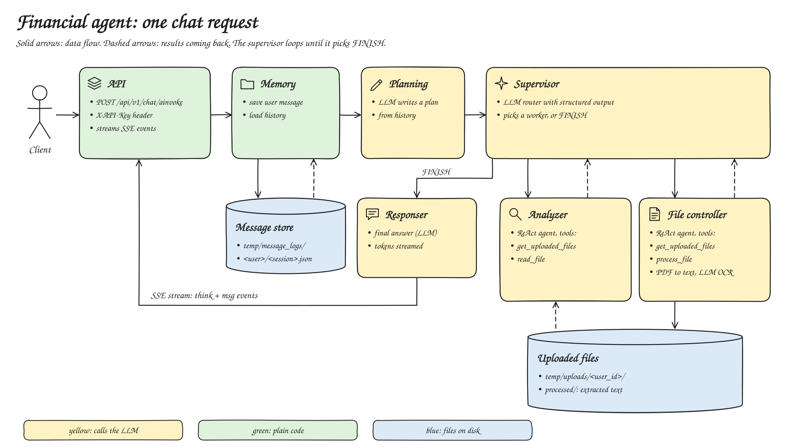
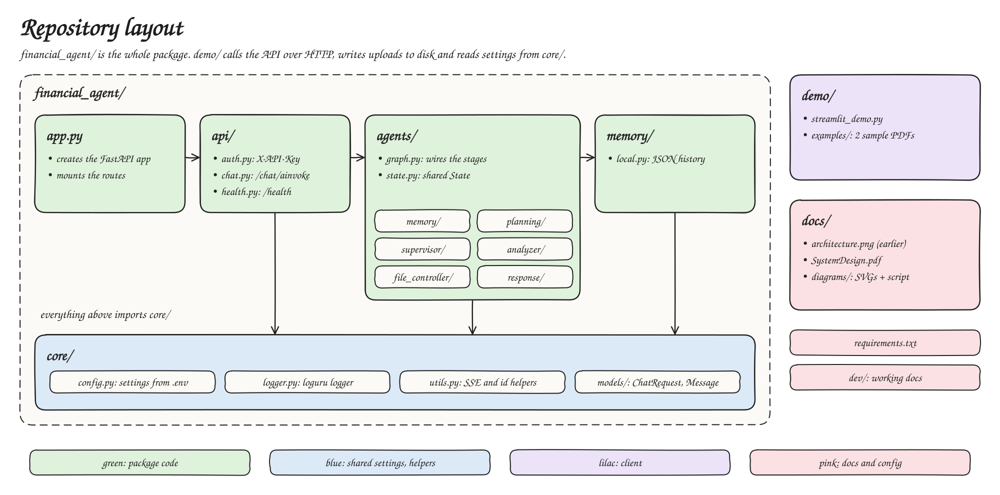

<div align="center">

# Financial agent

**A multi-agent assistant that reads uploaded financial documents and answers questions about them.**


[Architecture](#architecture) · [Agents](#agents) · [Quickstart](#quickstart) · [Project layout](#project-layout) · [Licenses](#licenses)

</div>

## What it does

The agent serves a chat endpoint over FastAPI. Each request goes through a LangGraph pipeline: it loads the conversation history, plans, and lets a supervisor route the work to an analyzer or a file controller before a responser streams the answer back as server-sent events. A Streamlit demo is included.

| At a glance | |
|---|---|
| Agent stages | 6 |
| Agent tools | 4 (2 per worker) |
| HTTP endpoints | 2 (`/api/v1/chat/ainvoke`, `/api/v1/health`) |
| LLM | `gpt-4.1-mini` by default (`llm_model_name` in `.env`) |

## Architecture

<p align="center"></p>

The supervisor is an LLM router: it picks the analyzer, the file controller, or FINISH, and each worker hands its result back to the supervisor. The earlier hand-drawn workflow is kept in [docs/architecture.png](docs/architecture.png); the detailed design is in [docs/SystemDesign.pdf](docs/SystemDesign.pdf).

<p align="center"></p>

<details>
<summary>Tech stack</summary>

| Part | Used |
|---|---|
| API | FastAPI, uvicorn, API-key header `X-API-Key` |
| Agents | LangGraph (`StateGraph`, `create_react_agent`), `langchain-openai` |
| Files | `pymupdf4llm` for PDF to text, LLM OCR for page images |
| Config | `pydantic-settings`, `.env` |
| Demo | Streamlit, `sseclient-py` |

</details>

## Agents

| Stage | Folder | Role | Calls the LLM |
|---|---|---|---|
| Memory | `agents/memory` | Saves the user's message and loads the history from a JSON file per session | No |
| Planning | `agents/planning` | Writes a plan from the history and the last message | Yes |
| Supervisor | `agents/supervisor` | Routes to a worker or FINISH | Yes |
| Analyzer | `agents/analyzer` | Reads the processed files. Tools: `get_uploaded_files`, `read_file` | Yes |
| File controller | `agents/file_controller` | Preprocesses uploaded files (PDF to text, LLM OCR). Tools: `get_uploaded_files`, `process_file` | Yes |
| Responser | `agents/response` | Writes the final answer, streamed to the client | Yes |

## Quickstart

Prerequisites: Python 3.12 or newer (older versions fail at import) and an OpenAI API key.

1. Install the dependencies: `pip install -r requirements.txt`
2. Create a `.env` file in the repo root:
   ```bash
   OPENAI_API_KEY=sk-...
   FASTAPI_KEYS=["choose-an-api-key"]
   AUTH_ENCRYPTION_KEY=<a Fernet key>
   ```
   Generate the Fernet key with `python -c "from cryptography.fernet import Fernet; print(Fernet.generate_key().decode())"`.
3. Start the server: `python -m financial_agent.app` (listens on `http://localhost:8000`)

Run every command from the repo root: the `.env` file and the `temp/` folders are resolved relative to it.

<details>
<summary>Call the API</summary>

```bash
curl http://localhost:8000/api/v1/health

curl -N -X POST http://localhost:8000/api/v1/chat/ainvoke \
  -H "X-API-Key: choose-an-api-key" \
  -H "Content-Type: application/json" \
  -d '{"user_id": "u1", "session_id": "s1", "message": "hi"}'
```

The chat response is a stream of `data: {"content": ..., "type": "think" | "msg"}` events: `think` carries the intermediate stages, `msg` the final answer.

</details>

<details>
<summary>Run the demo UI</summary>

With the server running, start the Streamlit demo from the repo root:

```bash
PYTHONPATH=. streamlit run demo/streamlit_demo.py
```

`PYTHONPATH=.` is needed because the demo imports `financial_agent`. Sample PDFs are in [demo/examples](demo/examples).

</details>

## Project layout

```
.
├── financial_agent/
│   ├── app.py             # FastAPI app, entry point
│   ├── api/               # auth, chat and health routes
│   ├── agents/            # LangGraph pipeline and its stages
│   ├── memory/            # JSON-file chat history
│   └── core/              # config, logger, utils, request models
├── demo/                  # Streamlit demo and sample PDFs
├── docs/                  # design PDF, earlier diagram, generated diagrams
└── requirements.txt
```

## Tests and roadmap

The repo has no tests yet.

## Licenses

<details>
<summary>Third-party licenses</summary>

The diagrams use the Patrick Hand font, SIL OFL 1.1, see [docs/diagrams/OFL.txt](docs/diagrams/OFL.txt). Regenerate them with `python docs/diagrams/make_diagrams.py`.

</details>

Code: the repository has no license file yet.
